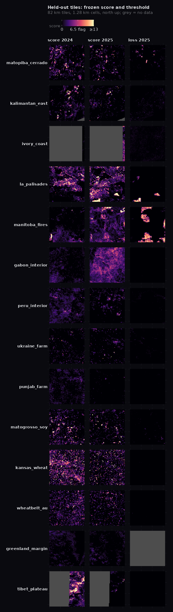

# AlphaEarth change pilot: can a 1.28 km map show where land changed in 2025?

**Verdict: the score works on held-out tiles on 3 of 4 frozen checks. The fourth (flagged cells piled on tile
edges) fails on its letter; the excess is real 2025 fires that happen to sit on tile edges. That call is the user's.**

Data: AlphaEarth Foundations Satellite Embedding v1 annual, 2017–2025 (Google, Google DeepMind; CC BY 4.0),
read anonymously as the 64×64 overview of each 81.9 km UTM file (one 1.28 km cell = the renormalized mean of
16,384 10 m vectors). Labels: Hansen GFC v1.13 lossyear averaged onto each cell; strict stable = inside an
Intact Forest Landscape 2025 polygon with no Hansen loss 2001–2025. Code: `analysis/aef_change_pilot.py`
(reads, labels) and `analysis/aef_change_stats.py` (score, gate); numbers in `aef_change_pilot.json`.

## The score

`nov3(k)` = cosine distance from year *k* to the closest of the three years before it, so a state seen recently
(the other crop of a rotation, regrowth after a fire) scores low.
`score = (nov3(2025) − median nov3(2020…2024)) / max(1.4826·MAD, 0.003)`: how unusual this year's novelty is for
this cell. Flagged above 6.5, the strict-stable 99.9th percentile on the pilot tiles, frozen before the held-out run.

Rejected on the pilot tiles (`aef_change_pilot.png`):
- raw 2024→25 distance flagged 95% of Iowa and 100% of a Bolivian tile at the stable 99th percentile: farmland and
  dry forest change every year;
- a z-score of raw distance against the cell's own history exploded in intact forest, where the spread is tiny
  (pooled AUROC 0.68);
- excess distance without the spread divisor still flagged 25–32% of Iowa in every year.

## Held-out tiles (chosen after the freeze)

| check (frozen) | result |
|---|---|
| strict stable flagged ≤ 0.5% | 0.50% of 2,997 cells: pass, at the limit |
| change tiles, AUROC 2025 loss vs no-loss cells ≥ 0.85 | MATOPIBA 0.90, LA fires 0.87, Manitoba fires 0.88: pass |
| farmland flagged ≤ 15% | Ukraine 0.1%, Punjab 0.0%, Mato Grosso 1.2%, Kansas 2.9%, WA wheatbelt 0.8%: pass |
| flagged cells on tile edges ≤ 1.5× chance | 1.58×: **fail**. 88 edge flags vs 58 expected from each tile's own edge share; 39 of the 88 lie on 2025 Hansen loss (Manitoba fires 23 of 24, LA 14 of 35, the rest of LA in burned town Hansen does not count); 10 are a 4-column sliver file in Côte d'Ivoire. Cells next to no-data are not the cause (0.2% of flags). |

What it catches: half of fresh 2025 clearing on the pilot tiles at the flag line, 41% in MATOPIBA, 73% of the LA
fires, but only 18% of the Manitoba fire cells (mid-year boreal fires move an annual embedding less).

## Things a map reader would see that are not land change

- The 2024→25 pair is noisier everywhere: intact-forest median year-to-year distance doubles (≈0.006 → 0.012).
  The spread divisor absorbs most of it, but a Gabon interior tile lights 2.1% in a diffuse wash (0.0% in 2024),
  and a faint orbit-swath diagonal shows in the Congo tile.
- A whole-region weather year: the Paraguayan Chaco tile flags 27% in 2025 against 2.4% in 2024.
- Partial files at UTM-zone edges (Côte d'Ivoire, Tibet): a global mosaic must take each cell from the file that
  covers it fully; on the pilot tiles, cells next to no-data flag at 33% vs 5% elsewhere and must be dropped.

## The global build, and what the pilot missed (score v2)

The first global build (v1, all 32,931 footprints with nine years) flagged 4.1% of 159M km², 71% of it in files
whose median cell was itself an outlier: in some files 2022 and 2025 sit ~0.025 from every other year in every
cell, so the Sahara and Sahel showed file-shaped blocks with straight edges (next-door files 43% vs 0% flagged).
None of the 26 pilot and held-out tiles held such a file, so the frozen checks could not see it.

Score v2 subtracts, each year, the median novelty of the file's scored cells (files with fewer than 64 scored
cells get no score). On the pilot and held-out tables at the unchanged threshold 6.5: intact forest 0.4%, AUROC
MATOPIBA 0.89, LA 0.87, Manitoba 0.91, farmland at most 4.5%, edges 1.49× chance; catch rates 55%, 65% and 7%.
Those tables were no longer unseen when v2 was chosen. Rejected: masking files by median score (a continuum;
real regional events such as Flin Flon and the Chaco sit inside it) and a local 9- or 15-cell median (large fires
vanish: Manitoba AUROC 0.74/0.82).

v2 flagged 1.7%; part-file steps were left in the Sahara, and deserts held 24.6% of the flags (2.55% of their area)
and Antarctica 11.8% (3.32%), against 0.6–2.9% elsewhere. The layer does not draw the Deserts & Xeric Shrublands
biome (RESOLVE Ecoregions 2017) or land south of 60°S; with both masked the build flags 1.73M of 123M km² (1.4%).

Left in and seen on the world map: wide Siberian rivers (Lena, Aldan, Yenisei) drawn as lines, where water or ice
changed; a region-wide patch in western Russia (31–42°E, 53–59°N, 10–27% of cells per file, smooth across the
UTM 36/37 boundary, so not one file's processing); scattered flags on the Moroccan and Algerian coast after the
2025 rains; a few short straight seams in North Africa.

## Named examples

GERD and Navi Mumbai airport change in the right years (GERD 2019→22 while the reservoir filled, distance to 0.39;
Navi Mumbai 2017→18 and 2021→23) but not in 2024→25, so Google's published examples are multi-year comparisons.
The LA January 2025 fires are the non-forest 2025 event the score finds.

## Bug caught on the way

AEF COGs are stored south-up (positive pixel height, origin at the south edge). Labels drawn north-up put Hansen
loss upside down against the embeddings; the within-tile AUROC came out 0.16. The reader now flips each overview to
north-up from the file's own transform and checks the origin against the index.
