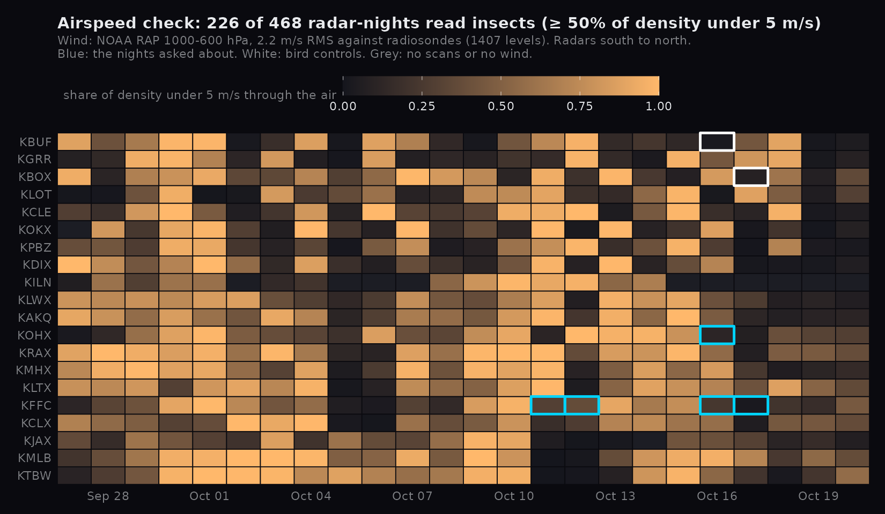
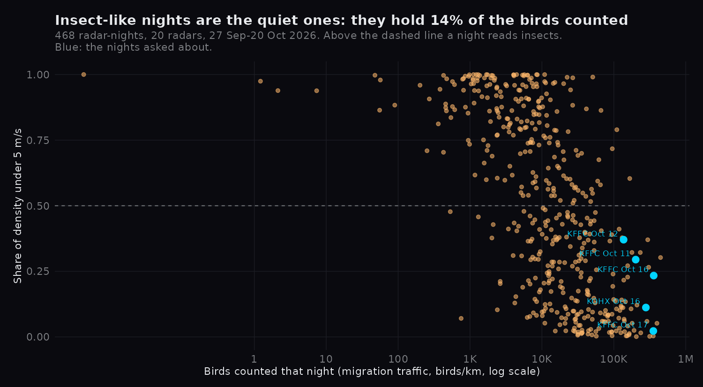

# Are a radar's big nights insects? (airspeed check)

Weather radar sees insects as well as birds. Birds fly through the air under their own power; most insects drift
with the wind. So the speed of the echo *through the air* (ground velocity from vol2bird minus the wind) separates
them. This check asks whether the spike nights at KFFC and KOHX in mid-October 2026 are insects.
Grill ledger: `grill_wildeye_insects_2026-10-20.md` (outside the repo) (closed 2026-10-21).

## Rules

Written 2026-10-21 20:46 EDT, before any bird airspeed was computed. Before that, two RAP hours (2026-10-17 00Z and
12Z) were fetched to check the file layout and the wind turn against radiosondes; no profile was touched.

- **Wind.** NOAA RAP hourly analysis (`noaa-rap-pds`, `awp130pgrbf00`, 13 km), geopotential height and u/v on
  1000-600 hPa, at the grid point nearest the radar, linear in height. Each profile takes the analysis hour nearest
  its time. RAP's u/v are relative to its Lambert grid; they are turned to north (`to_earth`).
- **Airspeed.** Per height bin with density > 0 and a velocity: |(u, v) - wind at the bin's middle height|.
- **Cutoff.** A bin is insect-like below **5 m/s** (Shi et al. 2025, *Ornithological Applications* 127: duaf020,
  doi:10.1093/ornithapp/duaf020, on vol2bird profiles; Horton et al. 2016, *Biology Letters* 12: 20160591, use 5.5).
  5.5 and 7 m/s (Cabrera-Cruz et al. 2013, *Condor* 115: 263, best cutoff 5.5-9 m/s in the tropics) are reported, not
  used.
- **Night verdict** (this check's own rule, not the papers'): **insects** when ≥ 50 % of the night's density
  (all bins of all profiles, sunset to sunrise, weighted by density) is insect-like; otherwise **birds**.
- **The wind did something.** A night is **void** when no profile found a wind, or the density-weighted mean of
  |airspeed - ground speed| is under 0.5 m/s.
- **The turn is right.** At every radar the turned grid x axis must match the grid's own drawn x axis within 0.2°
  (exact geometry); otherwise the run stops. (Planned first as "RAP turned beats RAP unturned against radiosondes";
  the two RAP hours above showed RAP-vs-radiosonde scatter of 1-5 m/s per level, larger than the turn itself,
  0.7-1.7 m/s, so that comparison cannot decide it.)
- **The wind is close to the real wind.** RAP vs radiosondes at 925, 850 and 700 hPa, 00Z and 12Z, at radars with a
  sounding site next to them: RMS vector error ≤ 3 m/s over ≥ 30 levels, else every verdict is void.
- **Controls.** KBUF 2026-10-16 and KBOX 2026-10-17 (cold, northern) must read *birds*, or the rule is broken. At
  least one of all 20 radars' nights from 27 Sep to 20 Oct must read *insects*; if none does, the rule has never been
  seen to catch insects and the popup says *unclear* instead of *birds*.
- **Nights asked about.** KFFC 10-11, 10-12, 10-16, 10-17; KOHX 10-16. The popup gets a line for these and for every
  other night that reads *insects*. Counts are never removed.

## Result: the nights asked about read birds



All gates held: the wind turn is right to 0.034° (limit 0.2°); RAP against radiosondes
2.2 m/s RMS over 1,407 levels (limit 3; unturned 2.4, turned the wrong way
3.1); both bird controls read birds; 226 nights read insects, so the rule has been seen to
catch some. Of 480 radar-nights: 242 birds, 226 insects, 1 void, 11 with no scans.

| night | role | birds counted (mt) | ground m/s | air m/s | share < 5 | < 5.5 | < 7 | verdict |
|---|---|---|---|---|---|---|---|---|
| KFFC 10-11 | asked | 201,334 | 16.4 | 6.2 | 0.29 | 0.35 | 0.66 | birds |
| KFFC 10-12 | asked | 136,696 | 10.1 | 5.9 | 0.37 | 0.48 | 0.77 | birds |
| KFFC 10-16 | asked | 358,355 | 17.7 | 6.4 | 0.23 | 0.31 | 0.75 | birds |
| KFFC 10-17 | asked | 354,107 | 17.5 | 8.6 | 0.02 | 0.04 | 0.10 | birds |
| KOHX 10-16 | asked | 278,925 | 16.1 | 7.4 | 0.11 | 0.15 | 0.31 | birds |
| KBUF 10-16 | control | 44,380 | 15.0 | 7.0 | 0.02 | 0.04 | 0.51 | birds |
| KBOX 10-17 | control | 30,612 | 17.6 | 7.1 | 0.08 | 0.17 | 0.38 | birds |



## What it says

- **KFFC's and KOHX's spike nights were birds riding tailwinds.** Ground speeds of 10-18 m/s, airspeeds of 6-9 m/s:
  most of the echo moved faster than the wind carried it. On KFFC 10-16 (358,355 birds/km) 23 % of the density was
  insect-like, so at least about three quarters of that count flew like birds.
- **Insect-like nights are the quiet ones.** Median 5,378 birds/km against 31,609 on bird nights; together
  they hold 14.5 % of all the birds counted. When little is migrating, what is left in the air drifts with
  the wind. The big nights, which carry the season totals, read birds.
- **The verdict leans on the cutoff.** At 5.5 m/s every asked night stays birds, but KFFC 10-12 is at 0.48. At 7 m/s
  (a tropical cutoff) KFFC 10-11, 10-12 and 10-16 would read insects. The airspeeds of bird nights here (6-9 m/s) are
  density-weighted means with any insects included, so they sit close to the cutoff. The popup shows them.
- **What it cannot say.** Airspeed alone cannot tell a fast insect from a slow bird, and a night's verdict hides
  mixtures (Shi et al. 2025 model the mixture instead). RAP is a 13 km model, not the wind over the radar.
  No ground truth for insects was used: the insect-like nights are a reading of the rule, not a confirmed count.

## Reproduce

```
uv run --python 3.13 --with pygrib --with numpy python -m pipeline.insect_check --vp-dir <vol2bird store> \
  --first-night 2026-09-27 --last-night 2026-10-20 --cache <dir> --out docs/analysis/bird_insects.json \
  --raob KFFC:KFFC,KOHX:KOHX,KBUF:KBUF,KOKX:KOKX,KLWX:KIAD,KMHX:KMHX,KTBW:KTBW,KPBZ:KPIT,KILN:KILN,KJAX:KJAX,KBOX:KCHH,KCLX:KCHS,KAKQ:KWAL,KMLB:KXMR
Rscript docs/analysis/bird_insects_figure.R
```

`--vp-dir` is the bird cron's vol2bird store (`build_birds.py --vp-dir`, kept 60 days). ~360 RAP hours, 2.3 MB each.
