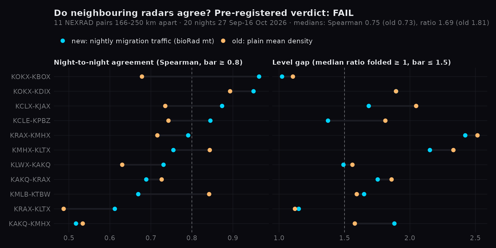

# Do neighbouring radars agree? (adjacent-radar check, G3)

Rules written to the grill ledger at 2026-10-17 17:40 EDT, **before any pair was computed**
(`~/.claude/projects/-home-mjarnold/memory/grill_wildeye_radar_depth_2026-10-16.md`); committed here with the result.

## Rules

- **Pairs.** No two of the 20 radars share air: vol2bird measures 5–35 km out and the closest pair is 166 km apart.
  The 11 neighbour pairs within 250 km are used (`pipeline/pair_check.py` `PAIRS`), so real differences
  between places count against the absolute bars; the comparison with the old product shares that confound.
- **Nights.** 27 Sep – 16 Oct 2026 (night D = bioRad sunset on D to sunrise on D+1), sampled the way the live
  layer is: the first volume of each 10-minute slot (`bird_nights backfill --every-min 10`).
- **Arms.** New: `mt_birds_km` (bioRad integrate_profile rules). Old: the layer's former `density_birds_km3`,
  averaged over the night with the same time weights.
- **Per pair.** Spearman over the nights both radars have; median of a/b over nights both are > 0, folded to ≥ 1.
- **Pass.** Over the pairs, median Spearman ≥ 0.8 **and** median folded ratio ≤ 1.5, **and** the new arm beats the
  old on both. All nights count. Rain nights dropped (either radar's `bio_gate_share` < 0.3) is a diagnostic only.

## Result: FAIL

| median over 11 pairs | new | old | bar |
|---|---|---|---|
| Spearman | 0.75 | 0.73 | ≥ 0.8 |
| folded ratio | 1.69 | 1.81 | ≤ 1.5 |
| Spearman, rain nights dropped (diagnostic) | 0.74 | 0.77 | – |

20,886 profiles (4 truncated archive volumes failed); 19–20 nights per pair, night coverage 0.91–0.94.
Per pair and per radar-night numbers: `bird_pairs.json`, `bird_pairs.csv`.

## What it says

- The new totals beat the old product on both medians, but narrowly, and not once rain nights are dropped.
  The integration is not what limits agreement.
- **Levels differ upstream of the integration.** Each pair's ratio is nearly the same in both arms
  (KOKX/KDIX 0.53 and 0.53), so it comes from vol2bird's density itself. Coastal radars read lower than their
  inland neighbours (KMHX median 5.2k birds/km against KRAX 19.8k and KAKQ 12.7k; KOKX half of KDIX).
  A 2.4× gap is ~3.8 dB, more than the usual NEXRAD calibration error; part of each coastal radar's
  measuring ring lies over the sea. Untested: a land-sector-only run (vol2bird azimuth limits) would show it.
- **Night-to-night agreement is radar-dependent:** KOKX–KBOX 0.96 and KOKX–KDIX 0.95, KAKQ–KMHX 0.52.

## Not shown

Agreement with an outside measurement (BirdCast), and whether neighbours 166–250 km apart should agree at
0.8 at all: the bar was set when the plan assumed pairs that share air.

Reproduce: `python3 -m pipeline.bird_nights backfill --every-min 10 --site … --night …` (~8 s per volume),
then `python3 -m pipeline.pair_check --vp-dir <store> --first-night 2026-09-27 --last-night 2026-10-16 --out bird_pairs.json`
and `Rscript docs/analysis/bird_pairs_figure.R`.
