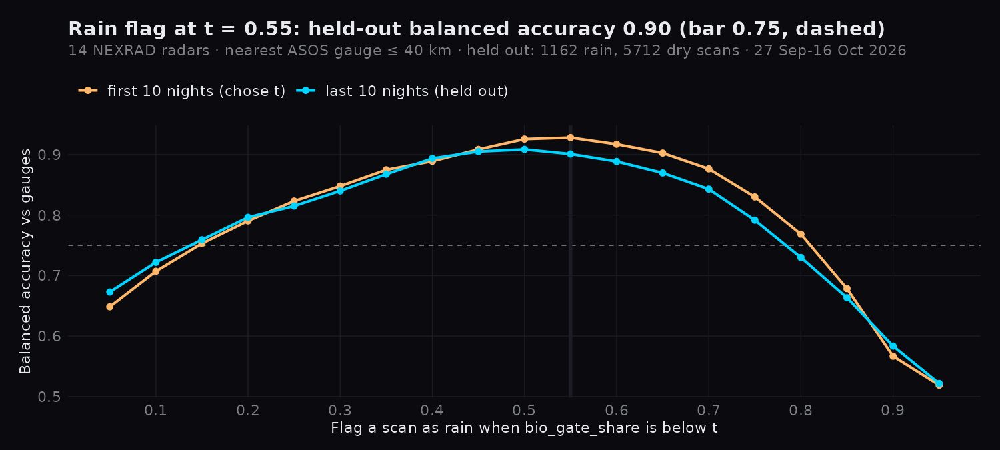

# When is a radar's bird count mostly rain? (rain flag)

vol2bird's dual-pol filter drops rain gates before it counts birds, so in rain the count rests on the few gates left.
`bio_gate_share` (kept gates / reflective gates, `pipeline/vol2bird.py`) measures that. This check sets the share
below which the globe marks a scan as unreliable, against airport rain gauges. Rules written to the grill ledger at
2026-10-18 21:30 EDT, **before any gauge was fetched** (`~/.claude/projects/-home-mjarnold/memory/grill_wildeye_radar_depth_2026-10-16.md`).

## Rules

- **Scans.** Every stored scan of the 14 radars in the adjacent-radar store, nights 27 Sep – 16 Oct 2026.
- **Gauge.** The nearest IEM ASOS station within 40 km of the radar; hourly METAR `p01i`.
- **Labels.** Rain: a report of ≥ 0.01 in within 60 min of the scan. Dry: the gauge reported nothing at all, not even
  a trace, in every hourly slot from sunset − 2 h to sunrise + 2 h (the station's own report minute). Everything else
  is left out.
- **Threshold.** Flag when share < t; t is the grid value (0.05–0.95) with the best balanced accuracy on the first ten
  nights, scored once on the last ten. Ships if held-out balanced accuracy ≥ 0.75 with ≥ 30 scans of each label.

## Result: ships at t = 0.55

Held out: balanced accuracy **0.90**; 89.5 % of 1,162 rain scans flagged, 9.3 % of 5,712 dry scans flagged.
(First version counted a night as fully reported with one hourly report missing; fixed in review, 457 held-out
dry scans dropped, threshold and verdict unchanged.)

| radar | gauge | rain scans | flagged | dry scans | flagged |
|---|---|---|---|---|---|
| KAKQ | AKQ 0 km | 107 | 0.64 | 1126 | 0.02 |
| KBOX | 1B9 7 km | 62 | 0.95 | 759 | 0.23 |
| KCLE | CLE 1 km | 210 | 0.93 | 825 | 0.00 |
| KCLX | 3J1 18 km | 99 | 1.00 | 974 | 0.12 |
| KDIX | MJX 10 km | 260 | 0.90 | 827 | 0.03 |
| KJAX | JAX 2 km | 302 | 0.84 | 611 | 0.02 |
| KLTX | SUT 33 km | 106 | 1.00 | 1200 | 0.21 |
| KLWX | IAD 5 km | 201 | 0.86 | 826 | 0.02 |
| KMHX | NKT 14 km | 77 | 0.99 | 1188 | 0.04 |
| KMLB | MLB 1 km | 247 | 0.96 | 817 | 0.17 |
| KOKX | HWV 5 km | 185 | 1.00 | 0 | – |
| KPBZ | PIT 5 km | 99 | 0.95 | 901 | 0.00 |
| KRAX | JNX 17 km | 37 | 1.00 | 1200 | 0.01 |
| KTBW | MCF 20 km | 134 | 0.71 | 894 | 0.03 |

All 20 nights; summary and curve in `bird_rain.json`.

## What it says

- A low share is rain most of the time: the flag finds nine in ten gauge-rain scans and the curve is flat from
  0.45 to 0.6, so the exact t matters little.
- Most "false" flags are at coastal radars (KBOX 23 %, KLTX 21 %, KMLB 17 %), where a dry gauge does not mean a dry
  35 km ring: offshore showers and sea clutter also leave few bird gates. So the globe says "mostly rain or clutter",
  not "raining".
- A gauge is one point; rain in the ring that misses it is labelled neither, so these rates are against what one
  gauge can see.

## Not shown

The six live radars outside the adjacent-radar store (no stored scans for these nights), and daytime scans.

Reproduce: `python3 -m pipeline.rain_check --vp-dir <store> --first-night 2026-09-27 --last-night 2026-10-16
--states NY,NJ,CT,NC,OH,PA,FL,MA,RI,VA,SC,GA,MD,DE --cache <dir> --out bird_rain.json` and
`Rscript docs/analysis/bird_rain_figure.R`.
