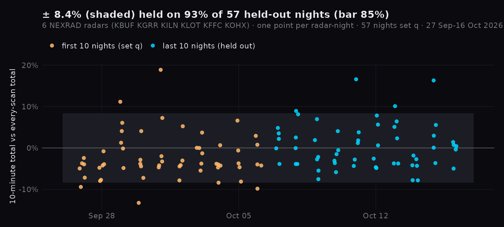

# How much does sampling every 10 minutes move a night's total? (night error bar)

The live layer runs vol2bird on one radar volume per 10 minutes; the radar makes one every 4-10 minutes. A night's
total (`mt_birds_km`, bioRad mt) is therefore built from a subsample. This measures that error, and only that error.

## Rules

Fixed in the radar-depth ledger (2026-10-18) before any of the data existed.

- Six radars the adjacent-radar store does not hold: KBUF, KGRR, KILN, KLOT, KFFC, KOHX; nights 27 Sep-16 Oct 2026.
- Truth: mt from every volume the archive holds (vol2bird pinned by digest, `pipeline/vol2bird.py`).
- Estimate: mt from the first volume in each 10-minute slot from sunset (the live cadence), from the same store.
- r = (estimate − truth) / truth on nights with truth > 0. q = 90th percentile of |r| over the first ten nights.
- Ship "± q" if, on the last ten nights, ≥ 85 % have |r| ≤ q, with ≥ 40 nights.

## Result: ships, ± 8.4 %

| | nights | |
|---|---|---|
| first ten (set q) | 57 | q = 8.4 % |
| last ten (held out) | 57 | 53 inside (93 %) |

Six KILN nights have no scans at all: the archive holds nothing for KILN from 2 Oct 14:03 to 3 Oct 17:49 UTC, from
5 Oct 16:39 UTC through 7 Oct, and after 15 Oct 23:46 UTC (two truncated volumes there failed in vol2bird). Those
nights have no truth and are left out, so each half has 57 nights, not 60.

The 10-minute total runs slightly low (median r −2.7 %; per radar −1.0 % to −3.9 %). The four held-out misses
(+9 % to +17 %) are all nights with 125-160 volumes against the usual ~105, i.e. the radar was in a faster
precipitation scan mode, where one volume in ten minutes represents more change.

## What it says

The popup now gives a finished night's total as "± 8%" from 10-minute sampling. That is the error of the
cadence alone. It does not say how many birds vol2bird misses or counts in error, or how one radar compares with
another (neighbours differ by a median 1.7×, `bird-pairs.md`). The globe shows no error bar on a night marked
mostly rain, nor on tonight before sunrise.

## Not shown

The other 14 radars (their stored scans are already a 10-minute subsample, so there is no truth), and rainy nights
as a separate class.

Reproduce: `python3 -m pipeline.sampling_check --full-vp <every-scan store> --site KBUF … --site KOHX
--first-night 2026-09-27 --last-night 2026-10-16 --out bird_sampling.json --subset-out <dir>` and
`Rscript docs/analysis/bird_sampling_figure.R`.
