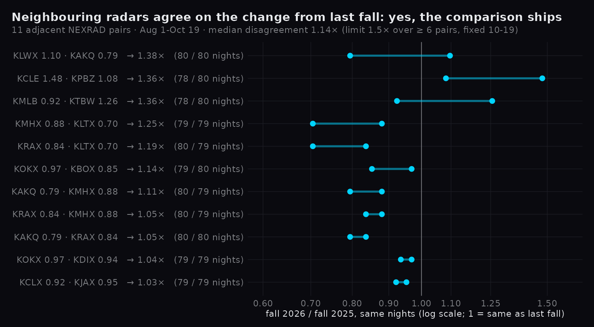

# Can a radar's fall be compared with its last fall? (season check)

Rule written to the grill ledger on 2026-10-19, **before either fall was in the archive**
(`~/.claude/projects/-home-mjarnold/memory/grill_wildeye_bird_season_2026-10-19.md`); code `pipeline/season_check.py`.

## Rule

- **Per radar.** r = fall 2026 total / fall 2025 total (`mt_birds_km`), over the nights by date that both falls have
  a total for, up to the last fall-2026 night in the archive.
- **Per adjacent pair** (the 11 pairs of `pipeline/pair_check.py`): disagreement = max(rA / rB, rB / rA). Birds move
  regionally, so neighbours should see a similar change; a radar whose change was hardware, scan strategy or siting
  stands out.
- **Ships** if the median disagreement is ≤ 1.5 over ≥ 6 pairs. Then the popup adds "Last fall on the same N
  nights: X (this fall Y)" (`SEASON_COMPARE` in `src/data/birds.js`, held to this file by `birds.test.mjs`).

## Result: ships

Median disagreement **1.14** over 11 pairs (range 1.03–1.38; no pair over 1.5). Radars' own ratios run 0.70 (KLTX)
to 1.48 (KCLE). Per radar and per pair numbers: `bird_season.json`.

## Data

- Fall 2025 (Aug 1 – Nov 15) and fall 2026 (Aug 1 – Sep 26) backfilled from the NEXRAD archive with the live rule:
  the first volume of each 10-minute slot, pinned vol2bird (jobd 6930–6935 on gt76, 228,335 profiles). Fall 2026
  from Sep 27 is the live cron's own archive, unchanged by the build.
- 3,265 nights added: 103–107 per radar in fall 2025, 71–80 in fall 2026 through Oct 19 (KILN off the air after Oct 14).
- vol2bird crashed on 43 archive volumes (rc 139 ×26, rc 255 ×17; the logs read say "Unexpected end of file", a
  truncated file); each costs its night one 10-minute sample and shows in that night's `coverage`.
- 50 volumes on 2025-10-20 are in the archive twice: an object re-uploaded on 2025-10-21 under an earlier key
  with the same bytes (ETag) as the later volume. `stored_profiles` now drops the copy (same time and rows) and
  still raises on two different scans with one time; before, those nights failed and were missing.

## Limits

- One comparison, made on Oct 19: fall 2026 is not over. The rule says nothing about re-checking; a re-run after
  Nov 15 would use the whole season.
- Two years only: agreement between neighbours says the change is regional, not that it is right.
