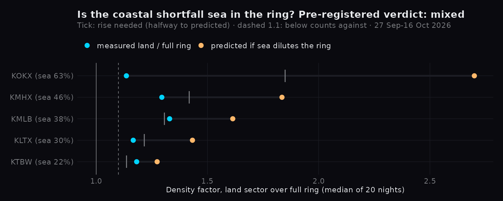

# Are coastal radars low because their ring is part sea? (land-sector probe)

Follow-up to the adjacent-radar check (`bird-pairs.md`), where coastal radars read below their inland neighbours.
Rules written to the grill ledger at 2026-10-17 23:00 EDT, **before any sector run**
(`~/.claude/projects/-home-mjarnold/memory/grill_wildeye_radar_depth_2026-10-16.md`).

## Rules

- **Geometry.** `pipeline/radar_sectors.py` gives each radar's range-weighted sea share over vol2bird's 5–35 km ring
  (Natural Earth 10 m land) and its widest non-wrapping sector that is ≥ 90 % land (`radar_sectors.json`).
  Five radars have real sea: KOKX 0.63, KMHX 0.46, KMLB 0.38, KLTX 0.30, KTBW 0.22; the rest ≤ 0.08.
- **Run.** Those five, the same 20 nights and 10-minute sampling as `bird-pairs.md`, vol2bird limited to the sector
  (`bird_nights backfill --vol2bird-option AZIMMIN=… --vol2bird-option AZIMMAX=…`).
- **Measure.** Per radar, median over nights of land-sector / full-ring old density product
  (`pipeline/sector_check.py`; density, not mt, because a narrow sector degrades vol2bird's wind fit).
- **Prediction if birds avoid the sea entirely:** factor = 1 / (1 − sea).
  **Supported** if ≥ 4 of 5 radars rise at least halfway to it; **falsified** if ≥ 4 of 5 stay below 1.1; else mixed.

## Result: mixed

| radar | sea | measured | needed | predicted |
|---|---|---|---|---|
| KOKX | 0.63 | 1.14 | 1.85 | 2.70 |
| KMHX | 0.46 | 1.30 | 1.42 | 1.84 |
| KMLB | 0.38 | 1.33 | 1.31 | 1.61 |
| KLTX | 0.30 | 1.17 | 1.22 | 1.43 |
| KTBW | 0.22 | 1.18 | 1.14 | 1.27 |

Two of five reach the needed rise, none stays below 1.1. 7,475 sector profiles (3 truncated archive volumes failed),
20 nights per radar. Per night: `bird_sectors.json`.

## What it says

- Every coastal radar reads more birds over land than over its whole ring, so the sea does dilute it, but by
  1.1–1.3×, not the 1.3–2.7× that a bird-free sea would give. Read through the same model, the sea strip holds
  roughly 30–80 % of the land density.
- **The coastal gap is mostly not sea.** The worst-placed radar, KOKX (63 % sea), rises least (1.14).
  With the five replaced by their land sectors (diagnostic only; G3 stays FAIL), the pair medians barely move:
  Spearman 0.75 → 0.77, folded ratio 1.69 → 1.69 (`bird_sectors_pairs.json`). KRAX–KMHX narrows 2.42 → 2.10
  but KOKX–KBOX widens 1.02 → 1.20.
- What is left between neighbours is radar- or place-specific (calibration, siting, real differences 166–250 km
  apart), and this layer cannot tell those apart without a shared-air or outside reference.

## Not shown

Calibration offsets per radar; whether the land sector's own land (KOKX's 40° sector is ~11 % of the ring's gates)
is representative of the land the full ring sees.

Reproduce: `python3 -m pipeline.sector_check --full-vp <full store> --sector-vp <sector store>
--sectors docs/analysis/radar_sectors.json --first-night 2026-09-27 --last-night 2026-10-16 --out bird_sectors.json`
and `Rscript docs/analysis/bird_sectors_figure.R`.
